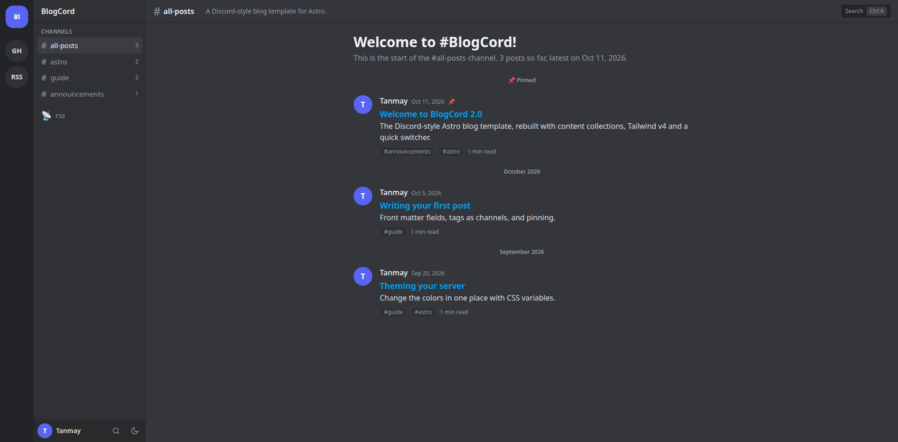
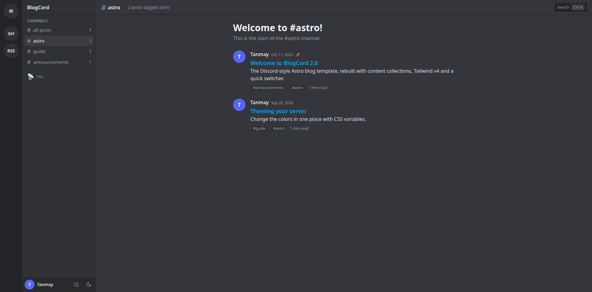
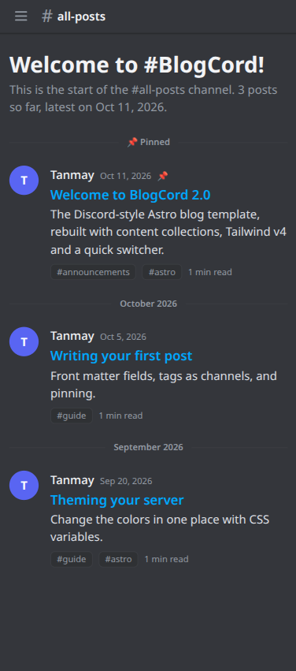
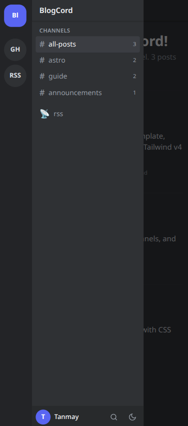

# BlogCord

A Discord-style blog template for [Astro](https://astro.build). Tags are channels, posts are messages, and `Ctrl+K` is the quick switcher.

[Live demo](https://blog-cord-ten.vercel.app/) · [Astro theme listing](https://portal.astro.build/themes/blogcordv2/)



## Features

- Server rail, channel sidebar and message-style feed; the sidebar becomes a drawer on mobile
- Content Collections: add a Markdown file, get a post
- Dark, light and AMOLED themes (CSS variables, remembered per visitor)
- `Ctrl/Cmd+K` search, RSS feed, sitemap, view transitions
- Optional [Giscus](https://giscus.app) comments
- Astro + Tailwind CSS v4, no client framework

## Screenshots

**Channel (tag) page**



**Mobile**: the feed, and the sidebar drawer

<p>
  
  
</p>

## Quick start

```bash
npm install
npm run dev      # http://localhost:4321
npm run build    # type-check + static build to ./dist
```

Requires Node 22.12 or newer.

## Make it yours

1. Edit `src/site.config.ts`: title, description, URL, author, server-rail links, Giscus.
2. Change colors in `src/styles/global.css` (`:root`, `[data-theme='light']`, `[data-theme='amoled']`).
3. Add posts in `src/content/posts/`:

```md
---
title: My post
description: One line shown in the feed.
pubDate: 2026-10-12
tags: [notes]
pinned: false
draft: false
---
```

Each tag becomes a channel. `pinned` pins a post to the top; `draft` hides it from production builds.

## Deploy

Static output works on Vercel, Netlify, Cloudflare Pages and GitHub Pages. For a subpath (GitHub Pages project sites) set `base` in `astro.config.mjs`.

## Structure

```
src/
  site.config.ts       site settings
  content.config.ts    post schema
  content/posts/       your posts
  components/          rail, channels, top bar, message, search
  layouts/Layout.astro app shell
  pages/               index, posts/[...id], tags/[tag], rss.xml, search.json, 404
  styles/global.css    theme tokens
```

## License

MIT